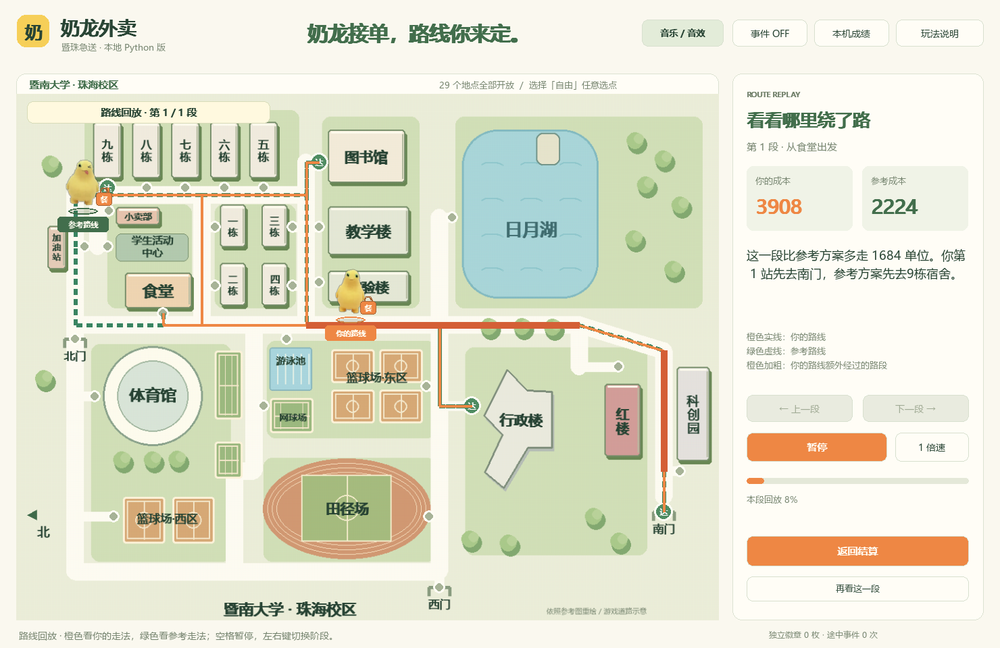
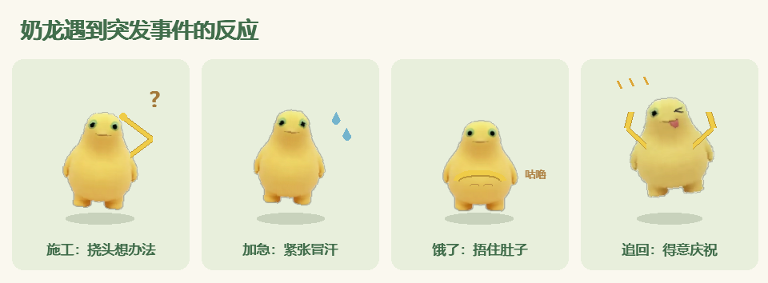

# 奶龙外卖 · 暨珠急送

在暨南大学珠海校区，让奶龙送餐，你来安排路线。一款面向校园算法比赛摊位的本地桌面小游戏，不需要懂编程也能玩。

## 下载即玩

**[下载 Windows 免安装版](https://github.com/aixuname/nailong-campus-delivery/releases/latest)**

在 Releases 下载 `nailong-campus-delivery-windows-x64-v1.0.0.zip`，完整解压后打开“奶龙外卖”文件夹，双击 **奶龙外卖.exe**。无需安装 Python，也不需要联网。适用 Windows 64 位，已在 Windows 11 测试。

请保留随包的 `_internal` 文件夹。成绩、音量设置和临时文件保存在程序旁的 `data` 中。可以为 exe 创建自己的桌面快捷方式。

## 游戏内容

- 清晰重绘的校园地图，全部 **29 个具名地点**可选。
- 4／6／8 单挑战与自由选点；食堂出发，送完最后一单即可。
- **拖动重排、边缘自动滚动、撤销和 Ctrl+Z**；已经送达的订单会锁定。
- 奶龙呼吸、歪头、眨眼、蹦跳送餐、摆动餐包，并随事件挠头、冒汗、捂肚子和庆祝。
- 本地制作的轻快循环音乐和 7 种音效，支持分别静音和调节音量。
- **双路线回放**：逐段播放玩家和参考路线，标出额外经过的路段，解释成本差，支持暂停、倍速和切换阶段。

## 四种途中事件

| 事件 | 玩家需要做什么 |
| --- | --- |
| 前方施工 | 观察锥桶和路障，重新安排剩余订单 |
| 突然加急 | 决定把新订单插入哪一站；两站内送达可获独立徽章 |
| 奶龙饿了 | 在食堂和小卖部之间选择补给点，考虑整段配送路线 |
| 捣蛋奶龙 | 跟着脚印，12 秒内点中三次，拿回餐袋获徽章 |

4 单挑战最多一次事件；6／8 单两次。至少先送两单，事件之间留出配送时间。事件期间暂停配送，追逐超时也能继续游戏。规划阶段另有奶龙探头彩蛋。

## 怎么操作

| 操作 | 功能 |
| --- | --- |
| 点击地图／订单 | 加入或移除配送地点 |
| 拖动已选订单 | 调整配送顺序 |
| Ctrl+Z | 撤销最近一次安排 |
| 空格 | 出发／继续；回放时播放或暂停 |
| N／F／H | 新一趟／配送加速／玩法说明 |
| M／S | 音乐开关／音效开关 |
| 1／2／3／4 | 4 单／6 单／8 单／自由 |
| 左右方向键 | 回放时切换阶段 |

## 算法与公平评分

每段道路使用 Dijkstra 求最低通行成本。互动事件前后分别记账，按每阶段的起点、任务和当时路况比较，再合计得分；后来封路不会改变已经走完的阶段。

每阶段最多 12 单时使用 Held–Karp 动态规划精确优化；更多订单使用多起点贪心和 2-opt，并明确标为“参考优选”。补给阶段还会比较食堂和小卖部两种方案。这个评分不代表预知所有未来事件的整局全局最优。

`路线得分 = 各阶段参考成本合计 ÷ 实际成本合计 × 100`，四舍五入且上限为 100。地图单位为示意图相对距离，独立徽章和规划时间不影响路线得分。

## 修改源码

源码位于 [source](source/)。建议使用 Windows 64 位 Python 3.13。

1. 进入 `source`，运行 `安装依赖.bat`，依赖仅安装到项目内 `vendor`。
2. 运行 `启动游戏.bat` 调试，或运行 `运行检查.bat` 验证功能。
3. 需要生成 exe 时，运行 `安装打包工具.bat`，再运行 `重新打包.bat`。
4. 产物位于 `source/.build/dist/奶龙外卖`，发布时保留整个文件夹。

自动检查覆盖算法、29 个地点、动画音频、四种事件、拖动撤销、事件节奏与只读回放。最终 exe 还支持 `--desktop-check`，会在程序旁的 data 中生成自检报告。

接手项目的开发者或 AI 助手请先阅读 [agent.md](agent.md)；[AGENTS.md](AGENTS.md) 提供同一份协作指引。更多细节见 [源码说明](source/README.md)。

## 素材说明

校园地图根据提供的参考图用程序重绘；奶龙角色图片来自提供的参考素材；动作、事件图案和音乐在项目中本地制作。
